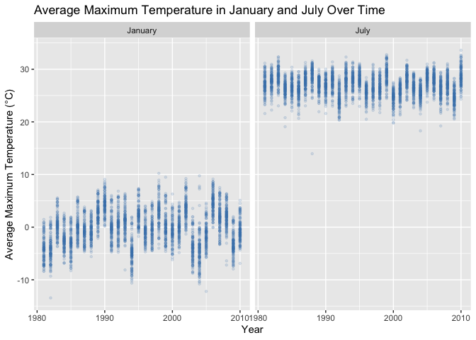
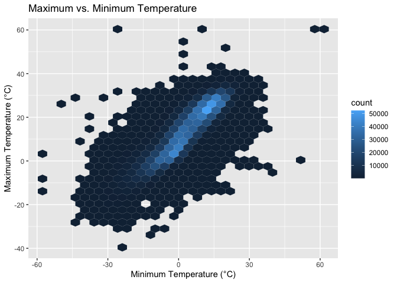
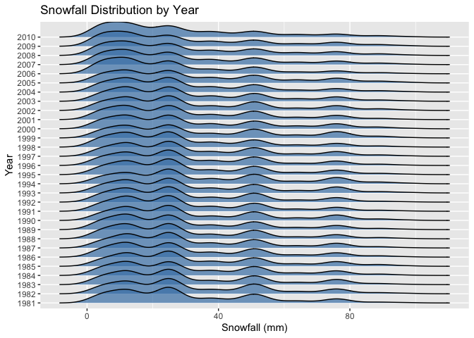
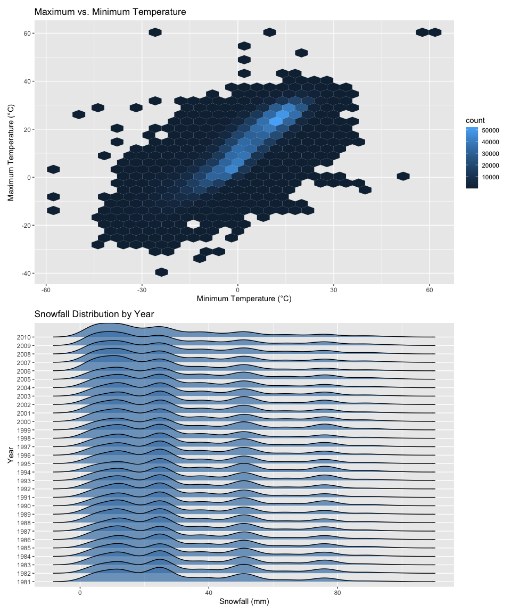

p8105_hw3_nw2614
================
Natasha Woon
2026-10-13

**Load Packages**

``` r
library(tidyverse)
library(p8105.datasets)
library(ggridges)
library(patchwork)
```

# Problem 1

**Loading Data**

``` r
data = ("ny_noaa")
```

**Counting Missing Values**

``` r
ny_noaa |>
  summarize(
    missing_id = sum(is.na(id)) / nrow(ny_noaa) * 100,
    missing_date = sum(is.na(date)) / nrow(ny_noaa) * 100,
    missing_prcp = sum(is.na(prcp)) / nrow(ny_noaa) * 100,
    missing_snow = sum(is.na(snow)) / nrow(ny_noaa) * 100,
    missing_snwd = sum(is.na(snwd)) / nrow(ny_noaa) * 100,
    missing_tmax = sum(is.na(tmax)) / nrow(ny_noaa) * 100,
    missing_tmin = sum(is.na(tmin)) / nrow(ny_noaa) * 100
  )
```

This NOAA data set has 2595176 observations anf 7 variables. The
variables in the data set include `id`, `date`, `prcp`, `snow`, `snwd`,
`tmax`, and `tmin`, which provides information on weather station ID
numbers, the date of observation, precipitation (in tenths of mm),
snowfall (mm), snow depth(mm), and the maximum and minimum temperatures
(in tenths of degrees C). Since there are many different weather
stations, and that each weather station may only collect a subset of the
variables, the data set has a lot of missing data. Upon investigation,
it is clear that the maximum and minimum temperature data is extensively
missing, with 43.7102532 % of observations missing for maximum
temperatures and 43.7126422% for minimum temperatures. Snow depth also
had a good amount of missing observations, with 22.8033089% of
observations missing.

**Problem 1 Questions:**

- Do some data cleaning. Create separate variables for year, month, and
  day. Ensure observations for temperature, precipitation, and snowfall
  are given in reasonable units. For snowfall, what are the most
  commonly observed values? Why?

**Cleaning the data set**

``` r
ny_noaa_df = 
  ny_noaa |> 
  mutate(
    month = lubridate::month(date), 
    year = lubridate::year(date), 
    day = lubridate::day(date), 
    tmax = as.numeric(tmax) / 10, 
    tmin = as.numeric(tmin) / 10, 
    prcp = prcp / 10 
  )
```

**Most Common Snowfalls**

``` r
ny_noaa_df |>
  count(snow) |>
  arrange(desc(n)) |>
  head()
```

    ## # A tibble: 6 × 2
    ##    snow       n
    ##   <int>   <int>
    ## 1     0 2008508
    ## 2    NA  381221
    ## 3    25   31022
    ## 4    13   23095
    ## 5    51   18274
    ## 6    76   10173

The most commonly observed snowfall value was 0mm. This makes sense
since that snowfall does not occur on most of the days of a given year.
The second most commonly observed snowfall value was NA, which indicates
that there was a substantial number of missing snowfall observations.
Other commonly observed values included 25mm, 13mm, 51mm and 76mm. When
converted into inches, these values round to approximately 1, 0.5, 2,
and 3 inches, which would make sense for New York City.

**Two Panel Plot Showing Max. Temperature in January and July**

- Make a two-panel plot showing the average max temperature in January
  and in July in each station across years. Is there any observable /
  interpretable structure? Any outliers?

``` r
temperature_df =
ny_noaa_df |>
  filter(month == 1 | month == 7) |>
  group_by(id, year, month) |>
  summarize(
    mean_tmax = mean(tmax, na.rm = TRUE)
  ) |>
  filter(!is.na(mean_tmax))
```

``` r
temperature_df |>
  ggplot(aes(x = year, y = mean_tmax)) +
  geom_point(color = "steelblue", alpha = 0.15, size = 0.9) +
  facet_grid(. ~ month,
             labeller = as_labeller(c("1" = "January", "7" = "July"))) +
  labs(
    title = "Average Maximum Temperature in January and July Over Time",
    x = "Year",
    y = "Average Maximum Temperature (°C)"
  ) 
```

<!-- -->

As expected, the average maximum temperatures were much higher in July
than in January because of seasonal temperature differences between the
Summer and the Winter. January temperatures generally range from
approximately -10°C to 10°C. July temperatures are generally range from
20°C and 32°C. Based on these two panels and where the points lie, there
is visibly no overlap between the two months. January temperatures seem
to fluctuate more across time, while July temperatures are relatively
more consistent. There are a few outliers. For the month of July, in the
late 1980s, the station captured an average maximum temperature of
around 14°C, which is much lower than other recorded observations. As
for January, there is an outlier in the early 1980s that captured a
maximum temperature around -14°C.

**Plot Showing Tmax vs. Tmin for Full Data Set**

- Make a two-panel plot showing (i) tmax vs tmin for the full dataset
  (note that a scatterplot may not be the best option); and (ii) make a
  plot showing the distribution of snowfall values greater than 0 and
  less than 100 separately by year.

``` r
tmaxvstmin_plot = 
ny_noaa_df |>
  ggplot(aes(x = tmin, y = tmax)) +
  geom_hex() +
  labs(
    title = "Maximum vs. Minimum Temperature", 
    x = "Minimum Temperature (°C)", 
    y = "Maximum Temperature (°C)" 
  )

tmaxvstmin_plot
```

<!-- -->

**Plot showing the distribution of snowfall values greater than 0 and
less than 100 separately by year**

``` r
snowfalldis_plot =
  ny_noaa_df |>
  filter(snow > 0, snow < 100) |>
  ggplot(aes(x = snow, y = factor(year))) +
  geom_density_ridges(fill = "steelblue", alpha = 0.7) +
  labs(
    title = "Snowfall Distribution by Year",
    x = "Snowfall (mm)",
    y = "Year"
  ) 

snowfalldis_plot
```

<!-- -->

**Combining the two plots into a two-panel plot**

``` r
tmaxvstmin_plot / snowfalldis_plot
```

    ## Picking joint bandwidth of 3.76

<!-- -->
