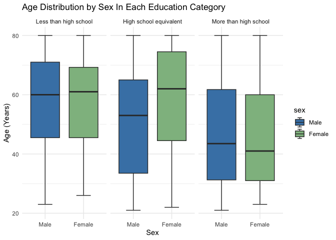
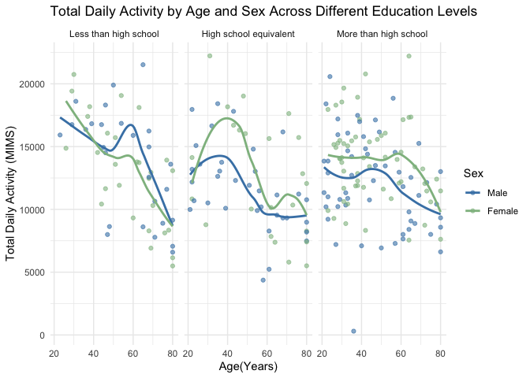
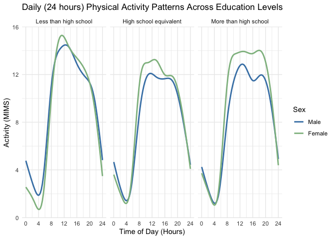

p8105_hw3_nw2614
================
Natasha Woon
2026-10-13

**Load Packages**

``` r
library(tidyverse)
library(p8105.datasets)
library(ggridges)
library(patchwork)
```

# Problem 1

**Loading Data**

``` r
data = ("ny_noaa")
```

**Counting Missing Values**

``` r
ny_noaa |>
  summarize(
    missing_id = sum(is.na(id)) / nrow(ny_noaa) * 100,
    missing_date = sum(is.na(date)) / nrow(ny_noaa) * 100,
    missing_prcp = sum(is.na(prcp)) / nrow(ny_noaa) * 100,
    missing_snow = sum(is.na(snow)) / nrow(ny_noaa) * 100,
    missing_snwd = sum(is.na(snwd)) / nrow(ny_noaa) * 100,
    missing_tmax = sum(is.na(tmax)) / nrow(ny_noaa) * 100,
    missing_tmin = sum(is.na(tmin)) / nrow(ny_noaa) * 100
  )
```

This NOAA data set has 2595176 observations anf 7 variables. The
variables in the data set include `id`, `date`, `prcp`, `snow`, `snwd`,
`tmax`, and `tmin`, which provides information on weather station ID
numbers, the date of observation, precipitation (in tenths of mm),
snowfall (mm), snow depth(mm), and the maximum and minimum temperatures
(in tenths of degrees C). Since there are many different weather
stations, and that each weather station may only collect a subset of the
variables, the data set has a lot of missing data. Upon investigation,
it is clear that the maximum and minimum temperature data is extensively
missing, with 43.7102532 % of observations missing for maximum
temperatures and 43.7126422% for minimum temperatures. Snow depth also
had a good amount of missing observations, with 22.8033089% of
observations missing.

**Problem 1 Questions:**

- Do some data cleaning. Create separate variables for year, month, and
  day. Ensure observations for temperature, precipitation, and snowfall
  are given in reasonable units. For snowfall, what are the most
  commonly observed values? Why?

**Cleaning the data set**

``` r
ny_noaa_df = 
  ny_noaa |> 
  mutate(
    month = lubridate::month(date), 
    year = lubridate::year(date), 
    day = lubridate::day(date), 
    tmax = as.numeric(tmax) / 10, 
    tmin = as.numeric(tmin) / 10, 
    prcp = prcp / 10 
  )
```

**Most Common Snowfalls**

``` r
ny_noaa_df |>
  count(snow) |>
  arrange(desc(n)) |>
  head()
```

    ## # A tibble: 6 × 2
    ##    snow       n
    ##   <int>   <int>
    ## 1     0 2008508
    ## 2    NA  381221
    ## 3    25   31022
    ## 4    13   23095
    ## 5    51   18274
    ## 6    76   10173

The most commonly observed snowfall value was 0mm. This makes sense
since that snowfall does not occur on most of the days of a given year.
The second most commonly observed snowfall value was NA, which indicates
that there was a substantial number of missing snowfall observations.
Other commonly observed values included 25mm, 13mm, 51mm and 76mm. When
converted into inches, these values round to approximately 1, 0.5, 2,
and 3 inches, which would make sense for New York City.

**Two Panel Plot Showing Max. Temperature in January and July**

- Make a two-panel plot showing the average max temperature in January
  and in July in each station across years. Is there any observable /
  interpretable structure? Any outliers?

``` r
temperature_df =
ny_noaa_df |>
  filter(month == 1 | month == 7) |>
  group_by(id, year, month) |>
  summarize(
    mean_tmax = mean(tmax, na.rm = TRUE)
  ) |>
  filter(!is.na(mean_tmax))
```

``` r
temperature_df |>
  ggplot(aes(x = year, y = mean_tmax)) +
  geom_point(color = "steelblue", alpha = 0.15, size = 0.9) +
  facet_grid(. ~ month,
             labeller = as_labeller(c("1" = "January", "7" = "July"))) +
  labs(
    title = "Average Maximum Temperature in January and July Over Time",
    x = "Year",
    y = "Average Maximum Temperature (°C)"
  ) 
```

<!-- -->

As expected, the average maximum temperatures were much higher in July
than in January because of seasonal temperature differences between the
Summer and the Winter. January temperatures generally range from
approximately -10°C to 10°C. July temperatures are generally range from
20°C and 32°C. Based on these two panels and where the points lie, there
is visibly no overlap between the two months. January temperatures seem
to fluctuate more across time, while July temperatures are relatively
more consistent. There are a few outliers. For the month of July, in the
late 1980s, the station captured an average maximum temperature of
around 14°C, which is much lower than other recorded observations. As
for January, there is an outlier in the early 1980s that captured a
maximum temperature around -14°C.

**Plot Showing Tmax vs. Tmin for Full Data Set**

- Make a two-panel plot showing (i) tmax vs tmin for the full dataset
  (note that a scatterplot may not be the best option); and (ii) make a
  plot showing the distribution of snowfall values greater than 0 and
  less than 100 separately by year.

``` r
tmaxvstmin_plot = 
ny_noaa_df |>
  ggplot(aes(x = tmin, y = tmax)) +
  geom_hex() +
  labs(
    title = "Maximum vs. Minimum Temperature", 
    x = "Minimum Temperature (°C)", 
    y = "Maximum Temperature (°C)" 
  )
```

**Plot showing the distribution of snowfall values greater than 0 and
less than 100 separately by year**

``` r
snowfalldis_plot =
  ny_noaa_df |>
  filter(snow > 0, snow < 100) |>
  ggplot(aes(x = snow, y = factor(year))) +
  geom_density_ridges(fill = "steelblue", alpha = 0.7) +
  labs(
    title = "Snowfall Distribution by Year",
    x = "Snowfall (mm)",
    y = "Year"
  ) 
```

**Combining the two plots into a two-panel plot**

``` r
tmaxvstmin_plot / snowfalldis_plot
```

    ## Picking joint bandwidth of 3.76

<!-- -->

# Problem 2

**Importing the data**

``` r
demographics_df = 
  read_csv(file = "data/nhanes_covar.csv",
           skip = 4,
           na = c("", "NA", ".")) |>
  janitor::clean_names()
```

    ## Rows: 250 Columns: 5
    ## ── Column specification ────────────────────────────────────────────────────────
    ## Delimiter: ","
    ## dbl (5): SEQN, sex, age, BMI, education
    ## 
    ## ℹ Use `spec()` to retrieve the full column specification for this data.
    ## ℹ Specify the column types or set `show_col_types = FALSE` to quiet this message.

``` r
accelerometer_df = 
  read_csv(file = "data/nhanes_accel.csv",
           na = c("", "NA", ".")) |> 
  janitor::clean_names() 
```

    ## Rows: 250 Columns: 1441
    ## ── Column specification ────────────────────────────────────────────────────────
    ## Delimiter: ","
    ## dbl (1441): SEQN, min1, min2, min3, min4, min5, min6, min7, min8, min9, min1...
    ## 
    ## ℹ Use `spec()` to retrieve the full column specification for this data.
    ## ℹ Specify the column types or set `show_col_types = FALSE` to quiet this message.

**Cleaning and Merging Data**

``` r
demographics_df_clean = 
  demographics_df |>
  filter(age >= 21) |>
  drop_na() |>
  mutate(
    sex = as.factor(sex), 
    sex = recode(sex, 
                 `1` = "Male",
                 `2` = "Female"), 
    education = as.factor(education),
    education = recode(education, 
                       `1` = "Less than high school",
                       `2` = "High school equivalent", 
                       `3` = "More than high school")
  )

final_merged_df = 
  left_join(demographics_df_clean, accelerometer_df, by = "seqn")
```

**Making a reader friendly table**

``` r
final_merged_df |>
  group_by(sex, education) |>
  summarize(n = n()) |>
  knitr::kable()
```

| sex    | education              |   n |
|:-------|:-----------------------|----:|
| Male   | Less than high school  |  27 |
| Male   | High school equivalent |  35 |
| Male   | More than high school  |  56 |
| Female | Less than high school  |  28 |
| Female | High school equivalent |  23 |
| Female | More than high school  |  59 |

Based on the table, it seems like most of the men in the sample (n = 56)
, and most of the women in the sample (n = 59) have an education level
that is more than high school. Overall, the sample is made up of 118 men
and 110 women.

**Creating a visualization of the age distributions of men and women in
each education category**

``` r
demographics_df_clean |> 
  ggplot(aes(x = sex, y = age, fill = sex)) +
  geom_boxplot(staplewidth = 0.5) +
  facet_wrap(~ education) + 
  scale_fill_manual(
    values = c("Male" = "steelblue",
               "Female" = "darkseagreen")
  ) + 
  labs(
    title = "Age Distribution by Sex In Each Education Category", 
    x = "Sex", 
    y = "Age (Years)"
  ) +
  theme_minimal() 
```

<!-- -->

Based on the boxplot, males and females who had a less than high school
education level had similar age distributions. The median ages and
interquartile ranges are very close to being identical.

There largest difference between in median age between men and women was
found in the high school equivalent education category. Women had a
median age of around 62 years, whilst men had a median age around 54
years. For individuals who had a more than high school education level
tended to be younger. The median age for men was approximately 44 and
the median age for women was approximately 41.

There is variability in age across all the different education
categories as the boxes are tall and the whiskers extend across a broad
range of ages.

**Calculating total daily activity**

``` r
final_merged_df = 
  final_merged_df |>
  mutate(
    total_activity = rowSums(across(min1:min1440), na.rm = TRUE)
  )
```

**Plotting total activity and age**

``` r
final_merged_df|>
  ggplot(aes(x = age, y = total_activity, color = sex)) +
  geom_point(alpha = 0.6) +
  geom_smooth(method = "loess", se = FALSE) +
  facet_grid(. ~ education) +
  scale_color_manual(
    values = c("Male" = "steelblue", "Female" = "darkseagreen")
  ) +
  labs(
    title = "Total Daily Activity by Age and Sex Across Different Education Levels",
    x = "Age(Years)",
    y = "Total Daily Activity (MIMS)",
    color = "Sex"
  ) +
  theme_minimal() 
```

    ## `geom_smooth()` using formula = 'y ~ x'

<!-- -->

Based on the scatter plots, there seems to be an association between age
and total activity in the day. Across all three education levels, as age
increases, the total activity in a day seems to decrease. This trend is
most noticeable among those with less than a high school education, as
there is a drastic decrease in activity as age increases.

There are some differences between men and women across education
levels. Among participants with a high school equivalent education
level, women generally have higher total activity levels as compared to
men during early and middle adulthood. However, activity levels across
men and women seem to become more similar at older ages.

Among men and women with more than a high school education, participants
show similar activity level patterns, with women having a slightly
higher level of activity.

It is important to note that there is a good amount variability in the
total daily activity within each education category as the data points
are spread widley. This may suggest that individuals who are of similar
ages and education level may still have considerably different activity
levels.

**Three-panel plot showing 24-hour activity**

``` r
final_activity_df = 
  final_merged_df |>
  pivot_longer(
    cols = min1:min1440,
    names_to = "minute",
    names_prefix = "min",
    values_to = "activity" 
  ) |>
  mutate(
    hour = as.numeric(minute) /60 
  ) |>
  ggplot(aes(x = hour, y = activity, color = sex)) +
  facet_grid(. ~ education) +
  geom_smooth(se = FALSE) +
  scale_color_manual(
    values = c("Male" = "steelblue",
               "Female" = "darkseagreen") 
  ) +
  scale_x_continuous(
    breaks = seq(0, 24, by = 4)
  ) +
  labs(
    title = "Daily (24 hours) Physical Activity Patterns Across Education Levels", 
    x = "Time of Day (Hours)",
    y = "Activity (MIMS)",
    color = "Sex"
  ) +
  theme_minimal()

final_activity_df
```

    ## `geom_smooth()` using method = 'gam' and formula = 'y ~ s(x, bs = "cs")'

<!-- -->

Across all three education levels, activity levels are lowest during the
early morning hours, around 4am. There is a sharp increase between 5am
and 9am, after which activity levels generally remain elevated
throughout the day before declining during the evening.

There are also some sex differences across education levels. For those
with an education level of less than high school, there seems to be very
little differences between men and women. Though, females still have a
slightly higher level of activity. However, the difference between sexes
is more prominent for participants with either a high school equivalent
education or more than a high school education. In both groups, women
generally have higher activity levels than men throughout the daytime.

It is interesting to note that for participants with less than a high
school education, their activity levels seem to reach their highest peal
around m idday, while those with higher levels of educaiton show
activity levels that are more sustained and consistent throughout the
daytime and afternoon.
